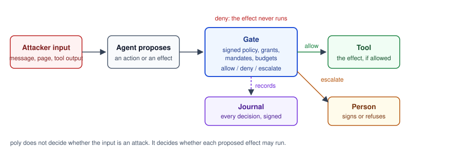

# poly and GenAI red teaming

*Cognitive Fab · November 2026 · read against the OWASP GenAI Red Teaming Manual v1.0 (October 2026) and the OWASP Top 10 for Agentic Applications 2026*

## Purpose

The OWASP GenAI Red Teaming Manual describes how to attack a GenAI system to find where it fails. poly is one of the defences such a test exercises: it checks the stateful core of an agent's program before it runs, and gates every effect the agent proposes while it runs. This page tells a red team where to look in a poly program, which commands and artefacts help, and what poly does not cover.

## Where an attack meets poly



The agent may be fooled. poly does not try to tell whether an input is an attack. It decides whether each effect the agent proposes may run: the gate reads the person-signed policy, the grants, the mandates and the budgets, and allows, denies or escalates to a person. Every decision is written to a signed journal. A red team therefore tests one question above all: can an effect get past the gate that the policy should have stopped?

## The eight phases

In the commands, `poly` stands for `node packages/poly-check/dist/src/cli.js`, run from the repository's root after `npm run build`.

| Phase | What poly gives the red team | Command or artefact |
|---|---|---|
| Planning | The rules that must hold, on one page. Policies, which govern effects at run time, are signed by a person (PT12.5). The rules inside a machine (invariants, `never` statements, path properties) are checked but not signed; signing them is planned for v2.0. | `poly rules <project>`; `policies/<scope>.sig.json` |
| Reconnaissance | Every effect is declared with its kind, labels, targets and class; every credential with its scopes and holder; every policy with its trust scope. The certificate binds them to the build. | the `.poly` sources; `poly admit` writes `.poly/certificate.json` |
| Attack surface mapping | For each trust scope, polycheck (an optional peer) checks the scope's effects against three dangerous combinations: `lethal-trifecta`, `credential-egress` and `source-egress`. One reachable without crossing a gate is `PL7001` with its path. A target no label grants is `PL6303`. Without polycheck, the regions stage is listed as not run. | `poly check <project>` |
| Exploitation | poly does not detect injection. It contains it: the test is whether an effect gets past the gate. `poly try` asks a policy file, without running anything, what it decides on the intents of a step. | `poly try <file> --machine M --ops <ops.json>` with a `gate` operation |
| Persistence | A machine's state is held by the runtime's store, not by the model's context. A memory item keeps its source, and only a person's signed record marks it verified (PL6837). A source can be forgotten. | the store; `poly memory-verify`, `poly forget` (a person's commands) |
| Impact assessment | The check explores every reachable state within the declared domains, and prints the instance it explored. A property that can fail comes with a shortest witness: the steps that break it. | `poly check`; `poly witness <id> --trace` or `--test` |
| Reporting | A witness exports as a trace or as a host test that replays it. A run is verified from the signed journal and can be replayed against the certified build. `poly report risks` counts, per rule, what it refused, escalated and allowed. | `poly witness`; `poly journal verify`, `poly journal replay`; `poly report risks` |
| Remediation | A finding becomes a policy rule, which a person signs, or a machine property, which the check then proves. `poly rules --check RULES.md` shows a rule a later change dropped. Rules mined from recorded traces are adjudicated by a person before they enter the sources. | `poly sign policy` (a person's command); `poly check`; `poly rules --check`; `poly mine`, `poly adjudicate`, `poly promote` |

## The OWASP Top 10 for Agentic Applications

The names are those of the OWASP Top 10 for Agentic Applications 2026. *Strong* means poly has a mechanism aimed at the risk's main path. *Partial* means it narrows the risk and leaves part of it outside. No row is *outside* entirely, and none is solved.

| Risk | Fit | Mechanism in poly | Limit |
|---|---|---|---|
| ASI01 Agent Goal Hijack | partial | A hijacked agent still proposes through the gate, so the policy bounds what it can do. A decision's answer is typed and stays in its declared domain. Content from an untrusted source carries a taint label that the flow rule follows to recipients (PS17). | poly does not detect that the goal changed. A hijacked agent can pick any action the policy allows. |
| ASI02 Tool Misuse and Exploitation | strong | Every effect is declared and proposed to the gate. A call outside an effect's targets is refused before the transport (PL6406). An irreversible effect must be retry-safe (PL4003). Budgets cap spend. | An allowed call with harmful arguments inside the declared domain passes. The policy is only as tight as written. |
| ASI03 Identity and Privilege Abuse | strong | A grant is checked before the policy: missing or too narrow is refused. The vault attaches the token, so a handler never holds it. A widened or revoked mandate is refused, and an effect outside the innermost mandate is denied. Approvals need a person's key; an agent's key is refused. | Identities and permissions outside poly (cloud roles, shared service accounts) are not seen. |
| ASI04 Agentic Supply Chain Vulnerabilities | partial | The certificate binds the build's artefacts, handler files and lockfile (PL6403), channel adapters (PL6408) and the policy engine's pinned version. Vendored engines are pinned by hash. | The model, the agent's prompts, its MCP servers and packages outside the certified handler closure are not covered. |
| ASI05 Unexpected Code Execution (RCE) | partial | A lint refuses ambient authority in handlers: file system, network, child processes, `fetch`, environment (PL6401). Handlers may run in an OpenShell sandbox generated from their labels (opt-in). No model call is on a check or decision path. | The agent's own shell or code tool is outside poly unless it is declared as an effect. The lint reads code; it does not run it. |
| ASI06 Memory & Context Poisoning | partial | A memory item keeps its source, and only a person's record verifies it. Taint and audience rules follow content to recipients (PL6831, PL6832). A source can be forgotten and erased. | poly does not judge whether stored content is true. The model's context window is outside. |
| ASI07 Insecure Inter-Agent Communication | partial | A send between machines in different trust scopes is proposed to the gate. A channel's sender claims come only from a certified adapter, which verifies the webhook. A replayed provider token is refused. | Agent-to-agent protocols that do not pass through poly's sends or channels are not covered. |
| ASI08 Cascading Failures | partial | Configurations check how machines relate over time: deadlock (PL3201), liveness (PL3301), `never` statements across machines. Retries are bounded, budgets cap cost, and an approved re-proposal is never escalated twice. | The check holds within its declared bounds; reaching a bound is INCONCLUSIVE (PL3901). An outside system is modelled only by the completions it is declared to return. |
| ASI09 Human-Agent Trust Exploitation | partial | An approval is a person's signed record for one escalation; the agent cannot approve, accept a finding or admit for a person. The re-proposal an approval triggers is decided again on the state at approval (S401): it is allowed or denied, and one that would escalate again is denied (PT9.7 rule 2). | poly does not see what the person was shown or told. A person who approves a misleading request signs it. |
| ASI10 Rogue Agents | partial | The agent proposes and the gate decides: an effect never runs outside it. The journal is signed and replays. `poly report risks` shows what each rule refused and escalated. | poly does not detect behaviour that drifts while staying inside the policy. An agent that does only allowed things is not flagged. |

## What poly does not cover

- **Attacks on the model itself.** Jailbreaks, harmful or biased content, data leakage in the model's text, and multimodal attacks are outside poly. A red team tests them with the manual's model and application techniques.
- **Prompt injection, as detection.** poly does not detect or stop injection. It limits what an injected agent can make happen.
- **Anything outside the declared domains.** The check explores the program within the domains it declares, at the values its instance prints. A value, a machine or an effect that is not declared is not checked.
- **Code and effects outside the program.** A tool the agent calls directly, not declared as a poly effect, never reaches the gate: it bypasses poly entirely.
- **Simulated attack worlds.** Running attacks against a program in a simulated environment is planned for v2, with polytrion.

## How to red team a poly program

The example is the airline desk (`examples/airline-desk`): a booking desk whose policy (polyaxion, signed per scope) says a booking is changed only after the customer confirms, a cancellation needs a checked customer and a reason, and a large compensation certificate waits for a person.

1. **Build the toolchain.**

   ```
   npm ci && npm run build
   ```

2. **Read the rules.** The page lists the policy's three obligations and the machines' rules, with their tags and signatures.

   ```
   poly rules examples/airline-desk
   ```

3. **Check the program.** Read the verdict, the instance it explored and the list of stages not run (the regions stage needs polycheck).

   ```
   poly check examples/airline-desk
   ```

4. **Probe the gate.** The `Booking` machine proposes a change whether or not the customer confirmed it; the policy must refuse an unconfirmed one. Write the operations to a file, `change-unconfirmed.json`:

   ```json
   [
     { "op": "dispatch", "action": "Change", "data": { "$claims": { "check": "Verified", "principal": "customer-1" } } },
     { "op": "intents" },
     { "op": "gate", "policy": "examples/airline-desk/airline-desk.policy.poly" }
   ]
   ```

   ```
   poly try examples/airline-desk/airline-desk.poly --machine Booking --ops change-unconfirmed.json
   ```

   The change is accepted by the machine and denied by the policy, with `airline.change-confirmed` as the reason. Try other sequences: confirm first, cancel without a reason, issue a large certificate. A gate decision here is computed from the policy file by poly-ref; the running gate is polyaxion.

5. **Seed a defect and get its witness.** `examples/refund-twice` holds a desk that pays twice:

   ```
   poly check examples/refund-twice/after/refunds-unguarded.poly --json
   poly witness <witness id> --trace
   ```

   The check reports `PL3002` on `no-reissue` with a two-step witness, and `PL4002` on the same step. Each finding's witness id is in the JSON report (`witness.id`) and in `.poly/report.json`; `poly witness` takes the id, or at least its first 12 hex digits, and writes the trace under `.poly/witness/` (or, with `--test`, a host test that replays it).

6. **Verify what happened at run time.** The kept store of the airline desk's scripted day is under `docs/examples/risk-report/airline-desk/`; its key ids are in `trust.json`. `poly journal verify` opens the store it is given for writing, so verify a copy of a committed store (`poly report risks` copies the store itself and writes nothing to it).

   ```
   cp docs/examples/risk-report/airline-desk/store.db /tmp/airline-desk.db
   poly journal verify --db /tmp/airline-desk.db --trust test-risk-report-airline-desk-ledger=docs/examples/risk-report/airline-desk/ledger.pub.pem
   poly report risks --db docs/examples/risk-report/airline-desk/store.db --build docs/examples/risk-report/airline-desk/build --certificate docs/examples/risk-report/airline-desk/certificate.json --trust test-risk-report-airline-desk-ledger=docs/examples/risk-report/airline-desk/ledger.pub.pem --trust test-risk-report-airline-desk=docs/examples/risk-report/airline-desk/admission.pub.pem --format md
   ```

   The report says, per rule, what it refused, escalated and allowed, and lists outcomes left unknown.

7. **Remediate.** Write the missing rule as a policy obligation or a machine property, run `poly check` until `CLEAN`, and have a person sign the policy (`poly sign policy <scope> --by <keyId> --key <file>`). Commit the rules page and run `poly rules --check RULES.md` in review, so a later change that drops the rule shows.

## Conclusion

poly gives a red team a program whose rules are written down, checked before it runs, and enforced at every effect while it runs, with a journal that records each decision. The test that matters is whether an effect gets past the gate, and the check, `poly try` and the journal help to find and replay one that does. What poly leaves to the rest of the defence is the model itself, injection as detection, anything outside the declared domains, and any tool the agent reaches without passing through poly.

## Sources

- OWASP GenAI Security Project, *GenAI Red Teaming Manual Version 1.0*, October 20, 2026: https://genai.owasp.org/resource/genai-red-teaming-manual-version-1-0/
- OWASP GenAI Security Project, *OWASP Top 10 for Agentic Applications 2026*, December 2025: https://genai.owasp.org/resource/owasp-top-10-for-agentic-applications-for-2026/
- poly: `docs/04-semantics.md` (PS), `docs/03-technical-spec.md` (PT), `examples/airline-desk`, `examples/refund-twice`, `docs/examples/risk-report/`.

## Glossary

- **Gate:** the runtime component that decides, for each proposed effect, allow, deny or escalate, from the signed policy, grants, mandates and budgets.
- **Effect:** a declared action on the outside world (a payment, a message, a booking change), proposed by the program and run only if the gate allows it.
- **Policy:** the rules of a trust scope that govern effects at run time, signed by a person; run by polyaxion.
- **Witness:** the shortest sequence of steps the check found that breaks a property.
- **Instance:** the finite part of the declared domains the check explored, printed with every verdict.
- **Journal:** the signed, append-only record of every step and gate decision, verifiable and replayable.
- **Region:** a dangerous combination of a scope's effects, such as private data, untrusted content and outbound communication together, checked by polycheck.
- **polytrion:** the simulation engine of the Poly stack, planned for v2.
